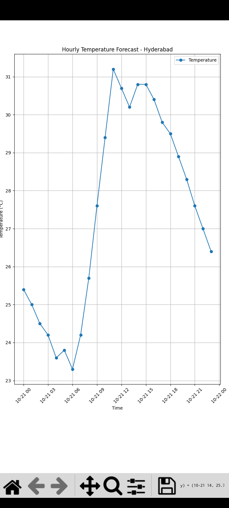

# Weather Data Science Project

## About
A beginner-friendly Data Science project using Python APIs,
Pandas, and Matplotlib to retrieve, analyze, and visualize
weather data.

## Features
- Retrieves weather data using the Open-Meteo API
- Displays temperature, humidity, and wind speed
- Analyzes hourly temperature data using Pandas
- Creates a temperature graph using Matplotlib
- Exports weather data to CSV

## Technologies
- Python
- Requests
- Pandas
- Matplotlib
- Open-Meteo API

## Installation
Install the required Python packages:

pip install requests pandas matplotlib

## How to Run
Run the desired Python file:

python weather_analyzer.py
python weather_analysis.py
python weather_chart.py

## API Key
The Open-Meteo example used in this project
does not require an API key.

## Learning Goals
Learn API requests, data collection, data analysis,
CSV files, and data visualization.

